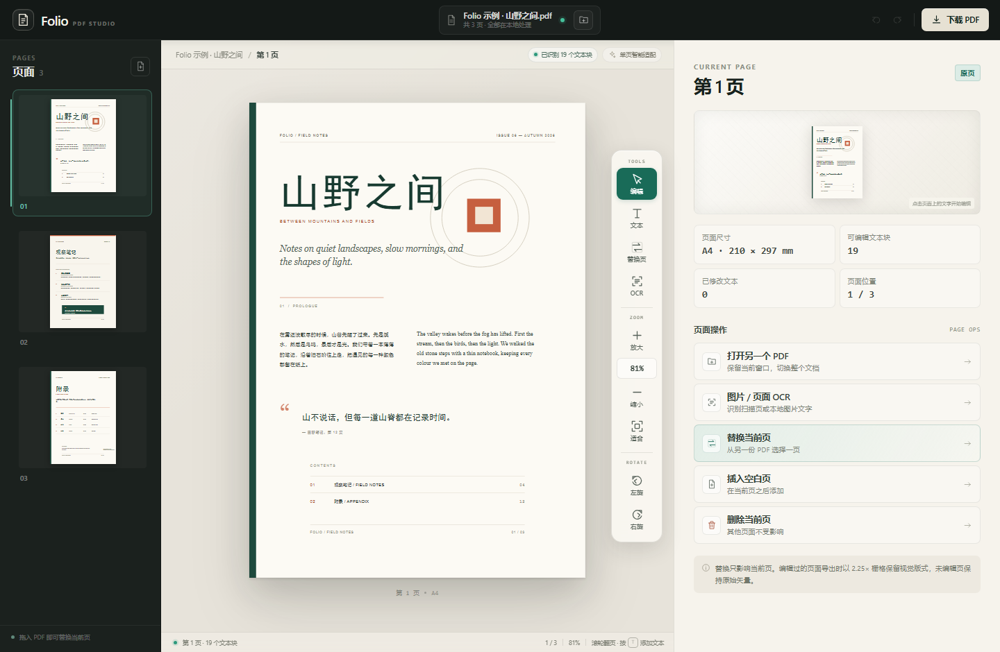

# Folio · PDF 文本工作室

一个单屏、纯前端的 PDF 文本编辑器。打开 PDF 后点击任意文字块，Folio 会从 PDF 字体表、字体描述符和页面像素中读取真实字体、字号、字重、颜色、行距与对齐方式；改写时自动换行，并优先压缩行距、必要时缩小字号，让内容留在原来的文本区域和这一页之内。文本框可以拖拽、八向缩放、显示对齐辅助线并自动吸附；页面可以整页替换。支持在窗口内切换另一份 PDF，以及针对扫描页/本地图片的离线中英文 OCR。



## 运行

在 Windows 上可以直接双击 `start.cmd`，或者：

```bash
node server.mjs
```

然后打开：

```text
http://127.0.0.1:4173
```

`server.mjs` 只使用 Node 内置模块，不需要安装依赖。默认只监听 `127.0.0.1`，不会把文件发送到网络。

也可以直接使用已经启动的本地服务（若仍在运行）。

## Windows 桌面版

已打包并部署到当前电脑：

| 产物 | 路径 |
| --- | --- |
| 一键安装包 | `dist/Folio-PDF-Studio-Setup-1.0.0.exe` |
| 已安装位置 | `%LOCALAPPDATA%\Programs\Folio PDF Studio` |

安装版会在桌面和开始菜单创建 **Folio PDF Studio** 快捷方式，安装到当前用户目录，不需要管理员权限。当前机器已经直接部署完成，可以直接双击桌面快捷方式启动。

卸载方式：开始菜单中的 **Uninstall Folio PDF Studio**，或 Windows 设置 → 应用 → 已安装的应用 → Folio PDF Studio。

安装包未购买代码签名证书；如果 Windows SmartScreen 提示「已保护你的电脑」，点击「更多信息 → 仍要运行」即可。

开发构建：

```bash
pnpm install
pnpm desktop     # 直接运行 Electron 桌面壳
pnpm dist        # 生成 electron-builder 的 NSIS 构建
```

正式一键安装包由 `build/oneclick` 中的脚本封装 `dist/win-unpacked` 生成，最终产物在 `dist/`。桌面壳使用 Electron，应用静态文件通过本机随机端口的临时 HTTP 服务加载，不依赖外网。

## 功能

- **单屏工作区**：左侧页面缩略图、中间纸张预览、纸张右侧竖排工具坞、加宽的右侧属性面板，无需跳转页面。
- **上下文样式识别**
  - 字体：读取 PDF 页面的真实字体资源（如 `SimHei`、`Microsoft YaHei`、`TimesNewRomanPSMT`、`Georgia-Italic`），将这些名称映射为本机字体；PDF.js 只提供通用字族时再用字体描述符的升降部指标和字符宽度做匹配。
  - 字重：优先读取字体名和 `/FontWeight` 描述符，可识别 Light、Regular、Bold 等；同指标的多个候选字体用字符宽度消歧。
  - 颜色：从页面渲染像素的核心墨色采样，而不是简单平均抗锯齿边缘，因此深色背景上的浅色文字也能得到接近原稿的颜色。
  - 字号、行距、对齐：由文本块的行框和基线计算，单行标题也会判断居中和右对齐。
- **自动换行与单页适配**
  - 编辑框保持原文本块的版心宽度；超过宽度时自动换行。
  - 先压缩行距（最低到单倍行高，不会把原本更紧的排版撑开），再按需缩小字号。
  - 编辑框最多向下扩展到下一个文本块或页面底边，绝不会压到后续内容。
- **常用 Word 排版工具**
  - 粗体、斜体、下划线、删除线。
  - 字号加减、字体、字重、颜色、对齐、行距、字间距。
  - 项目符号、编号列表、清除格式（恢复识别样式）。
  - `Ctrl/Cmd+B / I / U` 快捷键整段应用。
- **离线 OCR**
  - 识别当前 PDF 页面，或选择 PNG / JPG / WebP 本地图片。
  - 中文 + 英文混合识别，完全在本机完成，首次使用会加载约 30 MB 语言包。
  - 扫描页可「转为可编辑页」：按 OCR 行框恢复每行的位置、字号、颜色和对齐方式，生成可点击修改的文本块，尽量保持原扫描版式。
  - 也可以复制文字，或生成独立的干净文字页。
  - 扫描件、截图、图片型 PDF 都可以识别；不依赖云端接口或网络。
- **打开另一个 PDF**
  - 打开文档后，顶部文件名右侧的文件夹按钮、右侧「打开另一个 PDF」或 `Ctrl/Cmd+O` 都可以切换文档。
  - 如果有未应用的文本修改，会先确认；取消文件选择不会丢失当前编辑。
- **视图与页面旋转**
  - 纸张右侧竖排工具坞提供编辑、添加文本、替换页、放大、缩小、适合页面、左旋和右旋。
  - 当前页适配窗口时，直接上下滚动鼠标滚轮即可切换前后页；放大后先滚动页面，到达边缘后继续滚轮翻页。
  - 当前页可左旋 / 右旋 90°；旋转会同步缩略图、页面尺寸和导出方向。
  - 旋转视图下暂停文字编辑，转回正向即可继续；已修改文字的页面需先完成/撤销编辑再旋转。
- **文本框变换**
  - 八个缩放手柄：上下左右及四角拖动，实时重排文字。
  - 拖动顶部握把，或在移动模式下直接拖动文本框；移动不改变字号。
  - 移动模式（`Alt+M`）下用方向键微调，`Shift + 方向键` 加速。
  - 拖动/缩放时显示页边、页中线和其它文本块的左/中/右、上/中/下对齐辅助线。
  - 「自动吸附对齐」开关控制靠近辅助线时是否自动吸附；`Shift` 可临时关闭吸附。
- **PDF 页面替换**
  - 选择另一份 PDF，从缩略图中挑一页替换当前页。
  - 默认保持当前页面尺寸，将替换内容等比居中；也可以取消勾选，采用来源页尺寸。
  - 替换后会重新识别新页面的文本层，替换页上的文字仍可编辑。
- **页面操作**：插入空白页、删除当前页、撤销 / 重做、缩略图导航。
- **导出 PDF**：未编辑页面保持原始矢量内容；编辑过的页面在 2.25× 分辨率下栅格化，保留视觉版式并避免跨设备字体替换。
- **本地处理**：无上传、无账号、无网络请求（依赖库和示例全部在本地）。

## 使用方式

1. 点击「打开 PDF」或拖入 PDF。
2. 点击页面上的文字块，右侧会出现识别到的真实字体、字重、颜色和自动排版指标。
3. 直接改写文字；按 `Enter` 可以在任意字符之间手动换行。
4. 拖动八个手柄改变文本区域；拖动顶部握把移动文本框。
5. 点击「移动模式」或按 `Alt+M`，用方向键微调位置；靠近对齐线时会显示辅助线并按开关吸附。
6. 点击「应用更改」或按 `Ctrl+Enter`。
7. 在纸张上滚动滚轮可切换前后页；放大后可先滚读，再在边缘继续翻页。
8. 点击右侧「打开另一个 PDF」或 `Ctrl+O` 可以切换整份文档。
9. 扫描页可点击「图片 / 页面 OCR」识别；结果可复制、转为可编辑页或生成文字页。
10. 工具栏「替换页面」选择另一份 PDF 的任意一页。
11. 点击「下载 PDF」导出，未编辑页仍是原始矢量页。

首次体验可以点「打开示例文档」，编辑示例中的标题或正文，再用 `sample-replacement.pdf` 体验页面替换。

### 快捷键

| 快捷键 | 操作 |
| --- | --- |
| `V` | 编辑文字 |
| `T` | 添加文本 |
| `R` | 替换当前页 |
| `Alt+M` | 进入 / 退出移动模式 |
| `方向键` | 移动模式下逐点移动文本框 |
| `Shift + 方向键` | 移动模式下 10 点步进 |
| `Alt + 方向键` | 编辑状态下直接微调文本框 |
| `Ctrl/Cmd + B / I / U` | 粗体 / 斜体 / 下划线 |
| `Ctrl/Cmd + O` | 打开另一个 PDF |
| `Ctrl/Cmd + =` / `-` | 放大 / 缩小 |
| `Ctrl/Cmd + 0` | 适合页面 |
| `[` / `]` | 当前页左旋 / 右旋 90° |
| `Ctrl/Cmd + Z` | 撤销 |
| `Ctrl/Cmd + Shift + Z` | 重做 |
| `Ctrl/Cmd + S` | 导出 PDF |
| `Ctrl/Cmd + Enter` | 应用文字更改 |
| `滚轮` | 页面适配时切换前后页；放大后滚到边缘继续翻页 |
| `Esc` | 取消编辑 / 关闭弹窗 |
| `Ctrl/Cmd + 滚轮` | 缩放 |

## 技术说明

- PDF.js 负责渲染、文本层分析和缩略图；PDF-lib 负责读取字体资源、页面复制、替换页嵌入与导出。
- `pdf-fonts.js` 读取页面 `/Font` 资源里的 BaseFont、Ascent、Descent、ItalicAngle 与 FontWeight；`text-blocks.js` 用字体指标和实测字符宽度将其匹配到 PDF.js 的每个字体槽位。
- 文段按基线分组成行，再按字体 / 字重 / 行距 / 横向重叠合并为可编辑块。双栏页面会分别形成独立的文本块。
- 编辑时在原文字位置保留一块固定的背景补丁，因此文本框移动后原位置不会残留旧文字；导出时同样绘制原位置补丁。
- 文本颜色和背景色来自页面渲染像素采样，因此不需要解析每种 PDF 颜色空间。
- 页面替换不会改动其他页面；导出时原页直接 `copyPages`，未编辑的旋转页通过 `setRotation` 保持矢量，替换页用 `embedPdf` 保持矢量。
- 旋转页如果带有编辑内容会先走栅格化导出；旋转视图下文字编辑暂停，转回正向即可恢复。
- 下划线、删除线在预览和导出画布中都会绘制；Word 工具按整个文本块应用，不支持同一文本块内的局部多选格式。
- OCR 使用本地 `vendor/tesseract/` 中的 Tesseract.js + `chi_sim` / `eng` 语言数据，Worker 与 WASM 核心都不访问外网。
- 扫描页转可编辑会按 OCR 行框保留位置、字号、颜色和对齐；字体使用本机近似字体（中文 SimHei、英文 Arial），无法从图片中还原真正的字族、粗体或斜体细节。
- 打开另一个 PDF 复用同一个应用会话，会先处理未应用文本修改和未导出页面修改的确认。
- 依赖库已复制到 `vendor/`，运行时不依赖 `node_modules`。

## 目录

```text
index.html                  单屏界面
styles.css                  界面样式
src/main.js                 应用状态、页面导航、编辑会话、移动/缩放与 UI 交互
src/pdf-engine.js           PDF.js 加载、渲染、文本分析
src/pdf-fonts.js            PDF 字体资源与描述符读取
src/text-blocks.js          文本分块、真实字体映射、颜色检测
src/auto-fit.js             自动换行、行距/字号压缩、页内布局
src/exporter.js             PDF 导出与编辑页栅格化
server.mjs                  零依赖静态服务器
vendor/pdfjs/               PDF.js 与 CMap / 标准字体资源
vendor/pdf-lib/             PDF-lib
sample.pdf                  三页示例文档
sample-replacement.pdf      两页替换页示例
tools/                      示例生成脚本（开发用）
```

## 已知边界

- 扫描件 / 纯图片 PDF 没有文本层，不能直接改文字，但可以整页替换，或在空白区域添加文字。
- 编辑过的页面在导出后会变成图片，文字不可再被搜索或选中；未编辑页面仍保持矢量。这是为了在不同机器上稳定保留视觉版式。
- 本机未安装的嵌入字体只能回退到通用字族；PDF 字体表无法保证每台机器都具备同样的字体文件。
- 目前一次编辑一个文本块；不支持跨块同时选择或自动重排整页后续段落。移动文本框后可能与其它内容重叠。
- 页面旋转以 90° 为步进；旋转视图下暂停文字编辑，已带文字修改的页面需要先完成或撤销修改再旋转。
- 页面替换以整页为单位，不合并两份 PDF 的页面顺序。
- 推荐使用最新版 Chrome 或 Edge；需要 `CanvasRenderingContext2D.letterSpacing` 时效果最佳。
